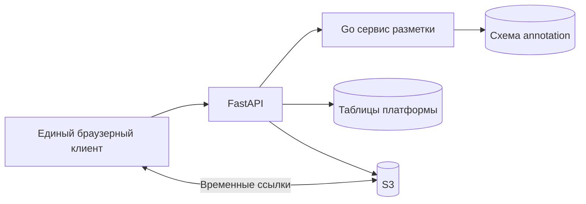

# Техническое задание на Go сервис заданий и разметки

Версия контракта: **0.1.0**. Дата: **8 ноября 2026 года**. Статус: **проект для согласования**.

Разработать самостоятельный HTTP-сервис на Go для назначения заданий, ручной разметки изображений рамками, хранения ревизий и независимой приёмки. Сервис должен сохранять согласованность разметки и состояния задания без распределённых транзакций с FastAPI. Результат принятой работы должен быть доступен Python-платформе в виде неизменяемого снимка для сборки датасета.

Формы HTTP-запросов, ответов и примеры зафиксированы в [OpenAPI](contracts/annotation-service.openapi.json). Ниже определены бизнес-правила, интеграция и критерии приёмки. Оба файла составляют один контракт; противоречия между ними исправляются до реализации соответствующей операции.

## Границы ответственности

| Go сервис и его разработчик | Python платформа и её разработчик |
| --- | --- |
| Задания, состав кадров, назначения исполнителя и рецензента | Пользователи, активность учётных записей и доступ к проектам |
| Рамки, атрибуты, автопроверки, ревизии | Загрузка, происхождение, лицензии, нормализация изображений |
| Отправка на проверку, приёмка и возврат | Оригиналы и неизменяемые рабочие изображения в S3 |
| История рецензий и аудит операций разметки | Публичный API и передача доверенного контекста пользователя |
| Снимки принятой разметки | Версии датасета, train/val/test, COCO/YOLO и хранение экспортов |

В эту задачу не входят браузерный редактор, обучение и запуск моделей, обработка видео, нормализация изображений, управление S3, импорт COCO/YOLO и сборка экспортных архивов. Редактор на TypeScript разрабатывается отдельной задачей по тому же HTTP-контракту. Go-сервис должен быть проверяем без редактора и без работающей Python-платформы.

В первой версии состав кадров и схема классов задания фиксируются при создании. Физическое удаление заданий, ревизий, рецензий и снимков через API отсутствует. Исправление принятой работы выполняется новым заданием; опубликованные результаты сохраняются.

## Схема взаимодействия



Для пилота используется один PostgreSQL с раздельными таблицами платформы и схемой `annotation`. У Go отдельные роль подключения и SQL-миграции. Рабочая роль Go не читает и не меняет таблицы Python; Python не читает и не меняет таблицы Go. Между схемами нет внешних ключей. Ссылки на проекты, пользователей и изображения проверяет платформа, а необходимые неизменяемые метаданные передаёт через API.

### Обязательства платформы

1. На каждом пользовательском запросе проверить активность пользователя и доступ к указанному проекту. Для операций изменения также проверить, что проект допускает изменения.
2. При создании задания разрешить переданные пользователем идентификаторы изображений в достоверные `ImageContext`. Проверить готовность и принадлежность каждого изображения проекту. Не принимать размеры и контрольные суммы из браузера как достоверные.
3. Перед назначением проверить активность, участие в проекте и допустимую роль исполнителя и рецензента. Исполнитель и рецензент должны быть разными людьми.
4. Защищать от физического удаления файлы, используемые в заданиях и версиях. `image_version_id` всегда обозначает одни и те же байты, размер и систему координат.
5. Для контекста кадра сначала получить разрешённый контекст из Go, затем добавить временную ссылку просмотра и срок её действия. Повторный запрос обновляет ссылку; Go её не хранит.
6. Отобразить ошибки Go и ошибки шлюза в едином формате для пространства `/api/projects/{project_id}/annotation/`. Существующий API авторизации этим контрактом не меняется.

Платформа хранит собственные данные и вызывает создание задания в Go с `request_id`. При неопределённом результате сети повторяет тот же запрос. Копия состояния задания в Python не становится самостоятельным источником истины.

## Идентификаторы и данные изображения

- Проекты, задания, элементы задания, версии изображений, рамки, отправки, рецензии, события и снимки имеют UUID.
- Идентификаторы пользователей — положительные целые числа, совместимые с существующим `users.id`; в JSON допустим диапазон до `9007199254740991`.
- Даты — RFC 3339 в UTC. Номера ревизий — целые числа. `task_revision` начинается с 1; ревизия документа разметки — с 0.
- `TaskItem` связывает задание с одним `image_version_id`. Внутри задания версия изображения встречается один раз. В разных заданиях она может размечаться независимо.
- `ImageContext` содержит `image_version_id`, `sha256`, `width`, `height`. Изменение этих полей существующего элемента задания запрещено.
- Задание сохраняет снимок схемы классов: UUID схемы, номер версии и список классов с уникальными `id`. Начальный проект содержит класс `horse`; экспортный индекс YOLO `0` не используется как внутренний идентификатор класса.

### Координаты и результат разметки

`Box` содержит UUID `id`, `label_id`, `xmin`, `ymin`, `xmax`, `ymax`, `occluded`, `truncated`. Координаты — конечные числа в пикселях рабочего изображения. Масштаб Canvas и размер окна в них не входят. Обязательны `0 ≤ xmin < xmax ≤ width` и `0 ≤ ymin < ymax ≤ height`. Правая и нижняя границы могут совпадать с размером изображения. UUID рамки сохраняется при редактировании и не повторяется внутри документа.

| `result` | Значение | Число рамок |
| --- | --- | --- |
| `unmarked` | Кадр ещё не размечен или результат намеренно сброшен | 0 |
| `has_objects` | Размечены объекты | Не менее 1 |
| `negative` | Пользователь явно подтвердил отсутствие лошадей | 0 |

Пустой массив не означает автоматически `negative`. Начальный ответ документа имеет ревизию 0, `unmarked`, пустые рамки и пустые предупреждения; автор и время сохранения равны `null`. Сохранённые ревизии начинаются с 1. Список истории первоначально пуст; запрос сохранённой ревизии 0 недопустим.

Геометрически некорректные рамки отклоняются с 422. Политика проверок версии 1 сохраняется в задании: сторона рамки меньше 4 пикселей даёт `small_box`, IoU строго больше 0.95 у пары рамок одного класса — `possible_duplicate`. Это предупреждения: они сохраняются с ревизией и не запрещают отправку. При приёмке рецензент должен явно подтвердить их просмотр. Изменение политики требует новой версии контракта или отдельного согласования; существующие задания сохраняют прежнюю политику.

## Права и состояние задания

FastAPI передаёт эффективную роль пользователя в проекте: `admin`, `manager`, `annotator` или `reviewer`. Способ её получения из учётной системы остаётся за платформой. Сервис Go доверяет этим сведениям только от аутентифицированной платформы.

| Действие | Допуск в Go |
| --- | --- |
| Создание и назначение | `admin` или `manager` |
| Чтение заданий, контекста и истории | `admin`/`manager`; аннотатор только своих заданий; рецензент только назначенных ему |
| Сохранение рамок | Только текущий исполнитель с ролью `annotator`, состояние `in_progress` или `returned` |
| Отправка на проверку | Тот же исполнитель и те же редактируемые состояния |
| Приёмка или возврат | Только текущий назначенный рецензент с ролью `reviewer`, состояние `submitted` |
| Создание и чтение снимков | `admin` или `manager` |

Роль администратора не даёт права менять замороженную разметку или принимать её вместо рецензента. Недоступный объект, в том числе объект другого проекта, возвращает 404. Если объект видим, но роль не разрешает действие, возвращается 403.

```text
создание → in_progress → submitted → accepted
                           ↓
                        returned → submitted
```

Создание сразу назначает исполнителя и рецензента. В `in_progress` и `returned` менеджер может менять назначения. В `submitted` разрешено заменить только рецензента, сохранив исполнителя; в `accepted` назначения неизменяемы. Каждое изменение назначения увеличивает `task_revision`. Сохранение рамок увеличивает ревизию документа, но не `task_revision`.

Каждый успешный переход состояния или изменение назначения увеличивает `task_revision` ровно на 1. Повтор запроса по сохранённому ключу не увеличивает ни один номер ревизии.

Рецензент не может быть исполнителем или автором какой-либо сохранённой ревизии этого задания. При отправке фиксируется множество таких авторов; новое назначение рецензента и решение проверяются по этому множеству. Это исключает самостоятельную приёмку после переназначения.

Каждая отправка создаёт новый `Submission`. Он фиксирует для каждого элемента конкретную сохранённую ревизию; состав больше не изменяется. Возврат разрешает новые ревизии документов. Предыдущие отправки, комментарии и решения сохраняются. Решение относится к конкретному `submission_id`, а не к текущей разметке кадра.

## HTTP контракт

Сервис принимает HTTP JSON внутри сети приложения. Платформа преобразует внешний префикс `/api/projects/{project_id}/annotation/` во внутренний `/v1/projects/{project_id}/`. Она не подменяет ответы Go, кроме добавления полей ссылки просмотра к контексту изображения и оформления собственных ошибок шлюза.

Все маршруты проекта требуют `Authorization: Bearer <service token>`, `X-Actor-ID`, `X-Actor-Role`. Служебный токен отличается от JWT-секрета и не передаётся браузеру. Платформа удаляет поступившие от браузера служебные заголовки и формирует их заново. `X-Request-ID` — UUID трассировки; при отсутствии Go генерирует его и возвращает в ответе. Он не заменяет `request_id` операции изменения.

### Операции сервиса

В таблице пути указаны относительно `/v1/projects/{project_id}`. Полные схемы и примеры приведены в OpenAPI.

| Метод и путь | Результат | Успех |
| --- | --- | --- |
| `POST /tasks` | Задание с доверенными изображениями, схемой классов и назначениями | 201 |
| `GET /tasks` | Только доступные пользователю задания | 200 |
| `GET /tasks/{task_id}` | Состояние, назначения и текущий `submission_id` | 200 |
| `PATCH /tasks/{task_id}/assignment` | Новые назначения и `task_revision` | 200 |
| `GET /tasks/{task_id}/items` | Элементы задания в фиксированном порядке, текущие ревизии и результаты | 200 |
| `GET /task-items/{task_item_id}/context` | Изображение, схема классов, состояние и возможности пользователя без S3 URL | 200 |
| `GET /task-items/{task_item_id}/annotations` | Текущий документ разметки | 200 |
| `PUT /task-items/{task_item_id}/annotations` | Полный документ новой ревизии | 200 |
| `GET /task-items/{task_item_id}/annotations/revisions` | Сохранённые ревизии от новой к старой | 200 |
| `GET /task-items/{task_item_id}/annotations/revisions/{revision}` | Неизменяемая сохранённая ревизия | 200 |
| `POST /tasks/{task_id}/submit` | Новая отправка с точными ревизиями и новой `task_revision` | 201 |
| `GET /tasks/{task_id}/submissions` | История отправок от новой к старой | 200 |
| `GET /tasks/{task_id}/submissions/{submission_id}` | Состав отправки, авторы и решение с комментариями | 200 |
| `POST /tasks/{task_id}/reviews` | Решение рецензента и новая `task_revision` | 201 |
| `POST /snapshots` | Метаданные снимка принятых отправок | 201 |
| `GET /snapshots/{snapshot_id}` | Метаданные снимка | 200 |
| `GET /snapshots/{snapshot_id}/content` | Сохранённые JSON-байты снимка | 200 |

`GET /healthz` не требует аутентификации и проверяет жизнеспособность процесса. `GET /readyz` проверяет соединение с БД и применённую версию миграций; при неготовности возвращает 503.

Списки используют `limit` от 1 до 100, по умолчанию 50, и непрозрачный `cursor`. Ответ имеет `items` и `next_cursor`, равный `null` в конце. Задания сортируются по `(created_at DESC, id DESC)`, кадры по фиксированной `position ASC`, ревизии и отправки по убыванию номера. Курсор связан с маршрутом и фильтрами; неверный курсор возвращает 422. При неизменном наборе повтор страницы не даёт пропусков или дублей.

Лимиты версии 0.1: JSON-тело до 8 MiB; от 1 до 10 000 кадров в задании; до 1000 рамок на кадр. Один снимок содержит не более 10 000 кадров, 100 000 рамок и 64 MiB сериализованных данных. Превышение размера тела даёт 413, нарушение лимитов содержимого — 422. Неизвестные поля тела и некорректные UUID отклоняются с 422; синтаксически неверный JSON — с 400. Обязательные поля не заменяются неявными значениями.

### Сохранение и повтор запроса

`PUT` заменяет весь документ кадра и принимает `request_id`, `expected_revision`, `result`, `boxes`. Ответ содержит сохранённые рамки и предупреждения, новую ревизию, автора и время. Авторы берутся из доверенного контекста; клиент их не задаёт. При несовпадении ревизии возвращается 409 `revision_conflict` с `current_revision`; существующие данные сохраняются.

Все операции изменения принимают UUID `request_id`. Для задания используются `expected_task_revision`; создание задания и снимка их не требуют. Идемпотентность определяется ключом `(project_id, actor_id, operation, request_id)`, где `operation` включает HTTP-метод и шаблон маршрута, а конкретный путь и валидированное содержимое входят в хеш запроса.

После проверки права видеть ресурс успешный повтор возвращает прежние HTTP-статус и тело, без новой ревизии и события аудита. Это действует и после изменения состояния задания. Другой путь или другое содержимое с тем же ключом возвращает 409 `idempotency_key_reused`. Порядок ключей JSON не влияет на сравнение. Неуспешные операции ключ не закрепляют. Успешные результаты хранятся вместе с историей без автоматического истечения в первой версии.

Одновременные одинаковые запросы должны дать один результат и одну запись. Запись результата запроса, доменные изменения и аудит входят в одну транзакцию. При сетевом сбое после commit клиент повторяет прежнее тело с прежним `request_id`; новая пользовательская правка получает новый UUID.

### Отправка и рецензия

`submit` принимает `request_id`, `expected_task_revision` и полный список пар `task_item_id`/`annotation_revision`, подтверждённых клиентом. Список должен точно совпадать с составом задания и текущими ревизиями. Пропущенные или повторяющиеся элементы дают 422, устаревшие ревизии — 409 `revision_conflict`. Все кадры должны иметь сохранённую ревизию и результат `has_objects` или `negative`; иначе 409 `task_incomplete`. В одной транзакции создаётся отправка и блокируется дальнейшее сохранение.

`reviews` принимает `request_id`, `expected_task_revision`, текущий `submission_id`, `decision` (`accept` или `return`), `warnings_acknowledged` и `comments`. Для возврата нужен хотя бы один комментарий с кодом правила и пояснением. Комментарий может ссылаться на элемент и рамку именно из этой отправки. При наличии предупреждений для приёмки необходимо `warnings_acknowledged=true`. Одна отправка получает одно решение; устаревшая отправка даёт 409 `submission_conflict`.

### Снимок для версии датасета

`POST /snapshots` принимает `request_id` и список принятых `submission_id` одного проекта. Сервис проверяет принятие каждой отправки. Повтор одной версии изображения в выбранном составе запрещён: 409 `duplicate_image_version`; сервис не выбирает разметку автоматически. Ответ содержит UUID снимка, формат, число кадров и рамок, SHA-256 и время создания.

Содержимое включает идентификаторы отправок и рецензий, версии изображений и их SHA-256/размеры, схемы классов, точные ревизии, результаты и рамки. Элементы упорядочиваются по `image_version_id`, рамки по UUID. JSON сериализуется один раз; сохраняются исходные UTF-8-байты и их SHA-256. `GET content` возвращает эти байты без повторной сериализации, включая заголовок `X-Content-SHA256`. Хеш не помещается внутрь хешируемого документа.

Python скачивает и проверяет снимок, сохраняет его рядом с манифестом версии, фиксирует разделение выборок и формирует экспорт. Повторная сборка этой версии использует тот же сохранённый снимок. Между созданием снимка в Go и фиксацией версии в Python нет общей транзакции: повтор по тому же `request_id` возвращает тот же снимок. Незавершённая версия в Python не публикуется.

### Ошибки

```json
{
  "error": {
    "code": "revision_conflict",
    "message": "Document revision has changed",
    "details": {"current_revision": 4},
    "request_id": "11111111-1111-4111-8111-111111111111"
  }
}
```

| HTTP | Коды и условие |
| --- | --- |
| 400 | `invalid_json` |
| 401 | `unauthenticated` — нет служебной аутентификации; во внешнем API также нет действующей пользовательской сессии |
| 403 | `forbidden`, `self_review_forbidden` — объект видим, действие запрещено |
| 404 | `not_found` — отсутствие объекта или права его видеть |
| 409 | `revision_conflict`, `task_revision_conflict`, `task_readonly`, `invalid_task_state`, `task_incomplete`, `submission_conflict`, `idempotency_key_reused`, `duplicate_image_version`, `submission_not_accepted` |
| 413 | `payload_too_large` |
| 422 | `validation_error` — `details.violations` с путём поля и пояснением |
| 503 | `temporarily_unavailable` — БД или схема не готовы |
| 502/504 | `upstream_unavailable` / `upstream_timeout` — ошибки FastAPI при обращении к Go |

Ошибка не должна раскрывать SQL, параметры подключения или секреты. Для всех конфликтов состояние остаётся неизменным. Порядок проверок: служебная аутентификация, корректность запроса и контекста, видимость/роль, успешный повтор, допустимость нового изменения. Для нового сохранения сначала проверяется редактируемость задания, затем текущая ревизия документа.

## Модель хранения

Названия таблиц ниже задают назначение и ограничения. Все они находятся в схеме `annotation`; внутренние технические поля могут быть добавлены без изменения контракта.

| Таблица | Основные поля и ограничения |
| --- | --- |
| `tasks` | UUID `id`, `project_id`, `title`, `assignee_id`, `reviewer_id`, `state`, `task_revision`, снимки `label_schema` и `validation_policy`, `current_submission_id`, даты. Исполнитель отличается от рецензента |
| `task_items` | UUID `id`, FK `task_id`, `image_version_id`, `image_sha256`, `width`, `height`, `position`. UNIQUE `(task_id, image_version_id)` и `(task_id, position)` |
| `annotation_documents` | PK/FK `task_item_id`, `current_revision`, первоначально 0. Создаётся вместе с элементом задания |
| `annotation_revisions` | PK `(task_item_id, revision)`, `result`, `boxes JSONB`, `issues JSONB`, `created_by`, `created_at`. Номера положительны, записи неизменяемы |
| `submissions` | UUID `id`, FK `task_id`, `number`, `state`, `submitted_by`, неизменяемые `contributor_ids`, `created_at`, `task_revision` на момент отправки. UNIQUE `(task_id, number)`. Состояния `submitted`, `returned`, `accepted` |
| `submission_items` | PK `(submission_id, task_item_id)`, `annotation_revision`. Составной FK на сохранённую ревизию; элемент принадлежит тому же заданию |
| `reviews` | UUID `id`, UNIQUE FK `submission_id`, `reviewer_id`, `decision`, `warnings_acknowledged`, типизированные `comments JSONB`, `created_at`, новая `task_revision`. Запись неизменяема |
| `snapshots` | UUID `id`, `project_id`, `format_version`, `created_by`, `item_count`, `box_count`, `sha256`, `content BYTEA`, `created_at`. Запись неизменяема |
| `snapshot_items` | FK `snapshot_id`, `submission_id`, `task_item_id`, `annotation_revision`, `image_version_id`. UNIQUE `(snapshot_id, image_version_id)`. Все ссылки ведут на принятый состав |
| `write_requests` | Уникальный ключ идемпотентности, хеш запроса, HTTP-статус и сохранённое тело успешного ответа |
| `audit_events` | UUID события, `project_id`, `actor_id`, роль, действие, тип/UUID объекта, `request_id` операции, ID трассировки, предыдущая/новая ревизии или состояние, дата |

Внутренние связи обеспечиваются FK и уникальными ограничениями, а не только проверками приложения. Для даты используется `timestamptz`. У запросов списков и поиска текущей разметки должны быть подходящие индексы. Полный JSON рамок не требуется дублировать в аудите: достаточно ссылки на неизменяемую ревизию и значимых переходов.

Сервис пишет событие для создания, назначения, сохранения, отправки, решения и создания снимка. История разметки и аудит не заменяются техническими логами. Рабочий пользователь БД не имеет UPDATE/DELETE для ревизий, решений, содержимого снимков и аудита; миграции выполняются отдельной ролью. Изменение состояния `submissions` разрешено только предусмотренными переходами.

## Транзакции и сбои

Все изменения одного задания используют одинаковый порядок: резервирование ключа запроса, блокировка строки задания, затем документов в фиксированном порядке. Сохранение и отправка сериализуются по строке задания. Сначала резервируется уникальный ключ идемпотентности; конкурентный одинаковый запрос ждёт результата первой транзакции либо продолжает после её rollback.

Сохранение выполняет проверку состояния, сравнение ревизии, создание снимка документа, обновление указателя текущей ревизии, аудит и сохранение ответа одним commit. Отправка дополнительно фиксирует полный состав и авторов; решение проверяет текущую отправку и рецензента. Нельзя держать транзакцию открытой во время HTTP-вызова Python или S3.

После падения процесса допускается только полностью применённая операция либо её полное отсутствие. Потерянный ответ не означает откат. Ошибка БД возвращает 503 без частичного результата. Ключи запроса предотвращают повторное изменение после неизвестного результата commit. Общий журнал Python/Go может собираться для просмотра, но не участвует в транзакции сохранения.

## Реализация и поставка

Код размещается в `services/annotation-go/` с собственным `go.mod`, зафиксированной поддерживаемой версией Go, Dockerfile, SQL-миграциями, тестами и README. HTTP-обработчики, бизнес-операции и SQL-доступ должны быть разделены. Библиотеки маршрутизации и драйвер PostgreSQL выбирает исполнитель; публичный контракт от этого не меняется. Форматы хранения объектов Konva или других UI-библиотек в API не используются.

Обязательные настройки: адрес прослушивания, строка подключения БД, служебный токен, тайм-ауты HTTP/БД. Значения секретов отсутствуют в исходниках, примерах и логах. Структурированные логи содержат метод, шаблон маршрута, статус, длительность и `X-Request-ID`; тела документов, `Authorization` и ссылки S3 не логируются.

Миграции запускаются отдельной командой до сервиса. README описывает запуск с отдельной тестовой PostgreSQL, применение миграций и вызовы с тестовыми actor-заголовками. Изменение корневого Compose, маршрутов FastAPI и хранения изображений выполняет владелец платформы; исполнитель предоставляет необходимые параметры и описание запуска своего контейнера. Контракт OpenAPI в `docs/contracts/` остаётся единственной общей копией.

## Критерии готовности

| ID | Проверка | Ожидаемый результат |
| --- | --- | --- |
| AC01 | Запуск на пустой PostgreSQL после миграций | Сервис готов; повтор миграций не повреждает схему |
| AC02 | Нет служебного токена, неверный токен или неполный actor-контекст | Запрос отклонён без чтения или изменения данных |
| AC03 | Чужой проект или неназначенный пользователь | 404; списки не раскрывают чужие задания |
| AC04 | Создание задания и повтор после потерянного ответа | Одно задание, неизменяемый состав, один аудит создания |
| AC05 | Чтение нового кадра и явный негативный результат | Ревизия 0 отличается от сохранённого `negative`; `unmarked` не отправляется на проверку |
| AC06 | Создание, изменение, удаление рамки полным PUT | Новая ревизия, стабильные ID оставшихся рамок; старые ревизии доступны |
| AC07 | Нулевые/обратные/внешние координаты, неверный класс, повтор UUID рамки | 422 без изменения документа |
| AC08 | Рамка ровно до правой/нижней границы и дробные координаты | Принимается; координаты не округляются до целых |
| AC09 | Маленькая рамка и возможный дубль | Предупреждения сохранены; отправка разрешена; приёмка требует подтверждения просмотра |
| AC10 | Два разных сохранения с одинаковым `expected_revision` | Одно успешно; второе 409, без потери принятой правки |
| AC11 | Два одновременных одинаковых `request_id` | Один commit, одна новая ревизия и одно событие; оба ответа совпадают |
| AC12 | Тот же ключ с другим содержимым или другим объектом | 409 `idempotency_key_reused` |
| AC13 | Одновременные сохранение и отправка | Либо сохранение включено в подтверждённый состав, либо отправка/сохранение получает конфликт; записи после заморозки нет |
| AC14 | Отправка с пропуском кадра, старой ревизией или `unmarked` | Отправка не создана; состояние и все документы прежние |
| AC15 | Возврат, исправление, повторная отправка | Новый `Submission`, предыдущие рамки, состав и комментарии неизменны |
| AC16 | Собственная приёмка, в том числе после переназначения | 403 `self_review_forbidden` |
| AC17 | Два решения или решение по устаревшей отправке | Одно решение; второй запрос конфликтует либо возвращает прежний ответ по тому же ключу |
| AC18 | Замена рецензента в `submitted` | Старый рецензент теряет право решения; отправленный состав не меняется |
| AC19 | Попытка изменения принятого задания | 409; ранее созданные снимки неизменны |
| AC20 | Снимок по непринятым работам или с повтором изображения | 409 без частичного снимка |
| AC21 | Повтор создания и скачивания снимка | Тот же UUID при повторе запроса, точные повторяемые байты, верный SHA-256 и количества |
| AC22 | Сбой до commit и потеря ответа после commit | После перезапуска нет частичных записей; повтор корректно определяет результат |
| AC23 | Пагинация заданий, кадров, ревизий, отправок | Нет пропусков/дублей на неизменном наборе; права применены до пагинации |
| AC24 | Проверка ограничений БД и ролей | Уникальность/FK работают; рабочая роль не может изменить историю или чужие таблицы |

Обязательны модульные тесты геометрии и переходов, интеграционные тесты на настоящем PostgreSQL и конкурентные тесты AC10–AC18. SQLite и in-memory хранилище не заменяют проверку транзакций. Исполнитель запускает `go test ./...` и `go test -race ./...` в поддерживаемой среде; race detector дополняет проверки бизнес-конфликтов.

Совместная приёмка с владельцем платформы отдельно проверяет, что FastAPI удаляет подставленные браузером actor-заголовки, проверяет актуальный доступ к проекту, разрешает достоверные метаданные изображений и добавляет ссылку просмотра только после проверки Go. Эти проверки требуют интеграции с Python и не заменяют самостоятельную приёмку сервиса по AC01–AC24.

Нагрузочный прогон использует 10 000 кадров и не менее 50 000 рамок суммарно по нескольким заданиям, не менее 10 параллельных клиентов в разных заданиях и отдельный сценарий конфликтов одного кадра. В отчёте фиксируются окружение, длительность, p50/p95, ошибки, итоговые количества и хеш снимка. Прогон должен завершиться без неожиданных 5xx, частичных записей и потери принятых изменений; ожидаемые 409 учитываются отдельно. Числовой SLA задержки не устанавливается без согласованного оборудования. Требование реферата к открытию кадра менее чем за секунду проверяется отдельно в составе frontend и S3.

Сдача включает исходники, миграции, конфигурационный пример без секретов, Dockerfile, инструкции запуска, актуальный OpenAPI, результаты проверок и демонстрацию полного сценария: создание → разметка → отправка → возврат → исправление → приёмка → снимок. Это подтверждает готовность Go-сервиса; готовность всего продукта также требует проверки FastAPI, редактора и экспорта.

## Параллельная работа

Для независимого старта подготовлен [комплект S0](go-service-start.md):
согласованные входные примеры, технические изображения и клиент проверки.
Go-разработка по контракту 0.1.0 не требует готовых API Python или S3.

Зависимости и точки совместной проверки со стороны платформы описаны в
[плане реализации Python](python-implementation-plan.md).

1. Зафиксировать контракт 0.1 и примеры. Исполнитель может начать сервис с доверенными тестовыми контекстами изображений и actor-заголовками, без Python и S3.
2. Владелец платформы готовит создание задания с достоверными метаданными, служебную аутентификацию, проверку проектных прав и добавление ссылки просмотра к контексту.
3. Исполнитель реализует хранение, ревизии и конфликты, затем отправку/рецензию и снимки. Каждый этап проверяется на PostgreSQL.
4. Провести совместный сквозной сценарий и проверки доступа AC02–AC03. Изменения HTTP-контракта синхронно вносятся в ТЗ, OpenAPI и обе реализации.

## Основания требований

- Реферат «Средство создания датасета детекции лошадей на изображениях фиксированной размерности»: разделы 3.1–3.5, приложения Б и В. Пороговые значения являются проектными; их изменение версионируется.
- [Транзакции в Go](https://go.dev/doc/database/execute-transactions).
- [Блокировки PostgreSQL](https://www.postgresql.org/docs/current/explicit-locking.html).
- [Схемы и права PostgreSQL](https://www.postgresql.org/docs/current/ddl-schemas.html).
